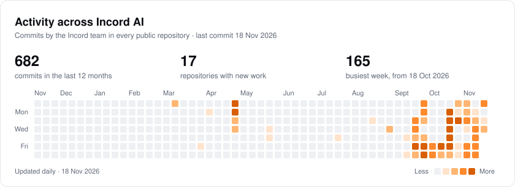
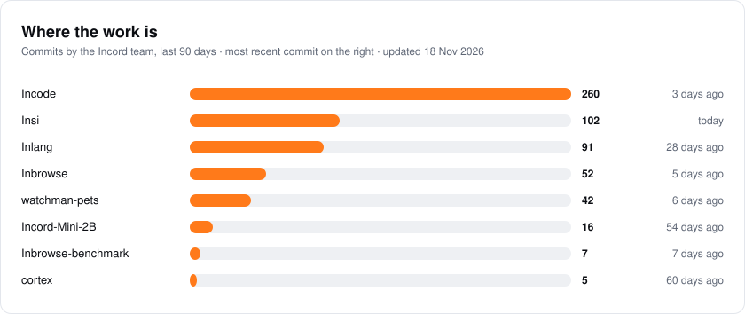

  <picture>
    <source media="(prefers-color-scheme: dark)" srcset="/assets/incord-logo-dark.svg">
    <source media="(prefers-color-scheme: light)" srcset="/assets/incord-logo-light.svg">
    
  </picture>

<h3>Intelligence, memory and automation for AI agents</h3>

The model isn't broken. Its window onto the world is.

  

  

## What we build

AI models are already extraordinary. What they lack is everything around them: memory that lasts, rules that hold, a check on the work before anyone calls it done, and a light way to read the web. Incord builds that layer. It is open source, written mostly in Rust, and it runs on your own machine.

## Start with Watchman

**[Watchman](https://github.com/incordai/Watchman)** is a harness for the AI coding agents you already pay for. It runs Claude Code, Codex, Cursor, Grok Build, OpenCode, Antigravity, Pi, omp, fx, Incord Code and Hermes on your own subscriptions, and gives all of them one shared memory.

- **Memory that fills itself.** Every session and every code edit is captured by Inmem, filed by project and handed back when it is needed. No "remember this".
- **Guards and review.** Rules stop an agent before a bad call runs, and an auditor reviews what the agent edited.
- **Context that is never lost.** Watchman watches the prompt cache, compacts only when it pays for itself, and hands work over cleanly between agents and models.
- **Voice mode.** Talk to your agents hands-free, with dictation in 12 languages.
- **Local models, free.** Search, speech, voice and text recognition run on your computer. Nothing is paid per use.
- **On your phone.** Pair it at [watchman.incord.ai](https://watchman.incord.ai) to follow your agents away from the desk.

> Watchman is in testing. Build it from source on Windows, macOS or Linux: [setup guide](https://github.com/incordai/Watchman#install).

## Activity

  <picture>
    <source media="(prefers-color-scheme: dark)" srcset="/profile/assets/activity-dark.svg">
    <source media="(prefers-color-scheme: light)" srcset="/profile/assets/activity-light.svg">
    
  </picture>

  <picture>
    <source media="(prefers-color-scheme: dark)" srcset="/profile/assets/repos-dark.svg">
    <source media="(prefers-color-scheme: light)" srcset="/profile/assets/repos-light.svg">
    
  </picture>

## Projects

### Agents and harnesses

| Project | What it does | Language | Updated |
| --- | --- | --- | --- |
| [**Watchman**](https://github.com/incordai/Watchman) | Harness for AI coding agents: shared memory, guards, an auditor, voice mode and free local models. | |  |
| [**Incode**](https://github.com/incordai/Incode) | Autonomous coding harness. It plans the work, runs every tool through its own guards, and marks a task done only when a command proves it. | Rust |  |
| [**Insi**](https://github.com/incordai/Insi) | Measures whether a coding agent really gets better at your repository, then improves it through draft pull requests that a person reviews. | Rust |  |

### Web

| Project | What it does | Language | Updated |
| --- | --- | --- | --- |
| [**Inbrowse**](https://github.com/incordai/Inbrowse) | Headless browser for AI agents and web scraping. Runs JavaScript on V8, speaks the Chrome DevTools Protocol, and works with Puppeteer and Playwright, in about 30 MB of memory on a simple page. | Rust |  |
| [**Inbrowse-benchmark**](https://github.com/incordai/Inbrowse-benchmark) | Conformance, speed, stealth and reliability benchmarks for Inbrowse, including a head-to-head with headless Chrome. | Rust, Python |  |

### Models and machine learning

| Project | What it does | Language | Updated |
| --- | --- | --- | --- |
| [**Incord-Mini-2B**](https://github.com/incordai/Incord-Mini-2B) | One Rust binary that serves the Incord model family: text and vision, text-to-speech, speech-to-text, embeddings and reranking, behind an OpenAI-compatible API. No Python, no CUDA. | Rust |  |
| [**Cortex**](https://github.com/incordai/cortex) | Tensor library and deep learning framework in Rust, so training and inference share one codebase. Built on [Burn](https://github.com/tracel-ai/burn). | Rust |  |

### Building with AI

| Project | What it does | Language | Updated |
| --- | --- | --- | --- |
| [**Inlang**](https://github.com/incordai/Inlang) | Describe a website in a few short words and inlang compiles them into a pre-rendered, locked-down site. The words are designed for an AI assistant to write. | TypeScript |  |

### For Watchman

| Project | What it does |
| --- | --- |
| [**watchman-characters**](https://github.com/incordai/watchman-characters) | Optional 3D characters for Watchman's voice mode, each under its own author's licence. |
| [**watchman-pets**](https://github.com/incordai/watchman-pets) | Optional third-party pets for Watchman, downloaded only by people who choose them. |

### Coming next

**[Inmem](https://github.com/incordai/Inmem)**, the memory engine inside Watchman, and **[Inveda](https://github.com/incordai/Inveda)**, a knowledge layer for agents, are on the way.

## How we build

- **Your machine first.** Watchman, its memory and its local models run on your own computer.
- **Proof over promises.** Incode calls a task done only when a command proves it. Insi counts an improvement only when it raises the pass rate on tasks it was not learned from.
- **Your agents, your subscriptions.** Watchman and Incode run the coding agents you already have, on your own subscriptions.
- **Open source.** Most projects are Apache-2.0. Watchman is Apache-2.0 with the Commons Clause.

## Get involved

Star a project, open an issue, or read its `CONTRIBUTING.md` to send your first pull request. Follow [@incordai](https://x.com/incordai) for releases.

 
<a href="https://incord.ai">incord.ai</a> · <a href="https://x.com/incordai">@incordai</a> · <a href="https://github.com/incordai">github.com/incordai</a>

